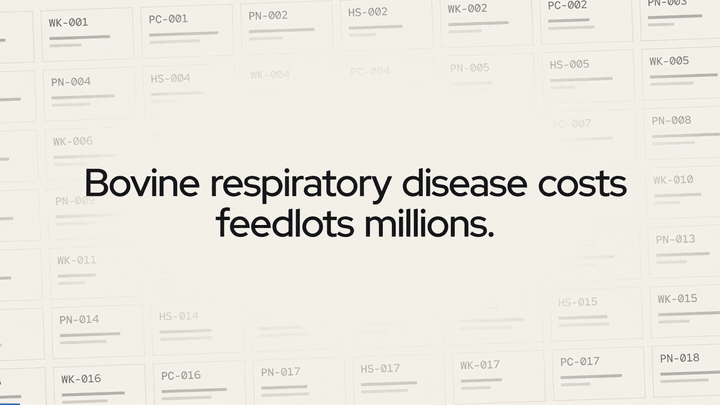

<h1 align="center">BRDashboard</h1>

<p align="center"><em>From cattle health data to better decisions.</em></p>

<p align="center">
  <strong>AISFS × Merck Animal Health Hackathon 2026</strong><br/>
  <strong>Challenge 1 — 45-day feedlot BRD decision platform</strong>
</p>

<p align="center">
  <strong>Team:</strong> Anish Koduri · Aaron Jacob · Amulya Bisaria
</p>

<p align="center">
  
  
  
  
  
  
</p>

<p align="center">
  <a href="#demo-video">Demo video</a> •
  <a href="#start-here">Start here</a> •
  <a href="#deliverables">Deliverables</a> •
  <a href="#trade-offs">Trade-offs</a> •
  <a href="#when-the-tool-cannot-support-a-confident-decision">Cannot support a confident decision</a> •
  <a href="#run-locally">Run locally</a> •
  <a href="#limitations">Limitations</a>
</p>

> [!IMPORTANT]
> Research demonstration and decision support. Not a diagnostic system. Not a prescription. The four yards are synthetic. They are not Merck records.

## Demo video

<p align="center">
  <a href="https://github.com/anishkoduri/BRDashboard/raw/main/BRDashboard-video/out/demo-small.mp4">
    
  </a>
</p>

▶ **Watch:** [demo-small.mp4](https://github.com/anishkoduri/BRDashboard/raw/main/BRDashboard-video/out/demo-small.mp4) (20 MB) · **Full quality (1080p):** [demo.mp4](https://github.com/anishkoduri/BRDashboard/raw/main/BRDashboard-video/out/demo.mp4). The submission ZIP carries the full-quality video at its root as `demo.mp4`. It runs 1:49, is filmed on the local dashboard, and follows the demo path below.

Local only. After the two processes below are running, the dashboard is [http://127.0.0.1:3000/](http://127.0.0.1:3000/). No deployed URL.

## Start here

**The 5-step demo path**
1. Open the dashboard: http://127.0.0.1:3000
2. Morning view: open lot WK-008 (Day 3 of 45).
3. Click "Generate today's plan": 100 assignments, 7 reviews unmet, and the screen says "Feasible, not proved."
4. Cut crew to 0.40: "PC staff hours does not fit PC-022." and "17 moved off the week."
5. Restore crew to 1.00: a fresh solve, again 100 assignments and 7 reviews unmet.

**Key verified numbers** (full-crew solve on seed `20261115`, data clock 2026-03-18)

| Result | Value |
|---|---|
| Priority lot | WK-008, Day 3 of 45 |
| Assignments | 100 |
| Unmet clinical reviews | 7 |
| Plan status | "Feasible, not proved." |
| Solver note | "Solver OPTIMAL." or "Solver FEASIBLE." (CP-SAT may return either on a repeat) |
| Crew cut to 0.40 | "Does not fit.", 0 assignments, 24 reviews listed, 17 moved off the week |
| Antimicrobial courses, current / proposed / hypothetical | 0 / 0 / 1,033 |

## Deliverables

Each rubric item, with where to find it.

| Rubric item | What it is here | Where |
|---|---|---|
| **Decision problem** | Which arrival lots need a person this week, which pen checks and veterinary-review slots fit the crew, and what that week costs against today's pen checks. | [The problem](#the-problem), brief §1 |
| **Data provenance** | Literature-informed synthetic demonstration, seed `20261115`. Four fictional yards. Not Merck observations. | `data/provenance/provenance.json`, `data/dictionary/data_dictionary.csv`, `data/demo/`, `backend/app/generate.py` |
| **Evidence** | Six source papers and an on-screen ledger stating what each source is and is not used for. | `research/sources/`, `backend/app/evidence.py`, Evidence screen, brief §1 |
| **Assumptions** | Every figure is labeled observed, estimated, or assumed. Price, loss, effectiveness, and labor inputs are shown on screen. | Brief §1–2, Scenarios screen, [Trade-offs](#trade-offs) |
| **Evaluation** | Reproducible demo case, 34 backend tests, Playwright tests. Synthetic-data recovery only, not clinical validation. | Brief §3, `tests/api/`, `tests/e2e/` |
| **Trade-offs** | Current approach, proposed week, and an unexecuted hypothetical protocol, side by side. | [Trade-offs](#trade-offs), Decisions screen |
| **Limitations** | Synthetic data, assumed coefficients, simulated review status, no weather feed. | [Limitations](#limitations), `docs/limitations.md` |
| **Reproducibility** | Seeded generator, one script that reprints the demo numbers, API and browser tests. | [Run locally](#run-locally), `scripts/reproduce_results.py` |
| **Demonstration case** | One end-to-end decision on the included set, with the capacity sensitivity table. | `docs/demonstration_case.md` |
| **Veterinary review** | Clinical reviews are requirements. Medication packages are review slots, not orders. | [Veterinary review](#veterinary-review) |

Submission items:

| Item | Path |
|---|---|
| This launch guide | `README.md` |
| Demo video | `demo.mp4` |
| Technical brief (3 pages excluding references) | `docs/technical_brief.pdf` and `docs/technical-brief.md` |
| Demonstration case | `docs/demonstration_case.md` |
| AI tools and external resources | `docs/ai_tools_disclosure.md` |
| Decision record and scope | `docs/decision-record.md`, `docs/scope.md` |
| Playwright tests | `tests/e2e/` and `playwright.config.ts` |
| API tests | `tests/api/` |
| Demonstration data | `data/demo/` |
| Data dictionary | `data/dictionary/data_dictionary.csv` |
| Generator | `backend/app/generate.py` |
| Model and optimizer | `backend/app/model.py`, `backend/app/optimize.py` |
| Provenance, assumptions, limitations | `data/provenance/provenance.json`, `docs/limitations.md` |
| Evidence ledger | `backend/app/evidence.py` |

## Who it is for

A feedyard manager opening the week. The same screens serve the cattle-health manager. The morning question is which arrival lot needs a person, whether this week’s pen checks and veterinary-review slots fit the crew, and what that choice costs. The tool does not diagnose, prescribe, or claim that a plan will save money.

## What it does

BRDashboard ranks arrival cohorts in the first 45 days on feed, builds one resource-feasible week with OR-Tools CP-SAT, and compares that week with the current pen-check approach.

- Morning names one priority lot and keeps observed pulls separate from estimated remaining pulls.
- Generate today’s plan assigns each active cohort one package. A clinical review that does not fit stays on the list.
- Cutting crew shows the shortage in a witness sentence. Restoring crew solves again.
- Prepare summary writes a page a manager can read without the rest of the app: the lot, the recommendation, the binding constraint, and the trade-off table.
- Decisions compares the current approach, the proposed week, and an unexecuted hypothetical protocol.

## The problem

The first 45 days after arrival are when a yard decides who gets a pen check and who gets a veterinary review. Staff hours, chute time, and review slots run out before every obligation is met. A risk number alone does not say which work fits this week, or what happens when the crew is cut.

## How it works

1. `backend/app/generate.py` writes the synthetic demonstration from seed `20261115`. The API loads `data/demo/` on startup.
2. `backend/app/model.py` scores each cohort. Observed first treatments update the rate. Arrival shifts are labeled assumptions. Three or more missing fields is an insufficient file.
3. `backend/app/optimize.py` solves the week with CP-SAT. Clinical reviews are requirements. If they do not fit, the obligation stays listed and the screen says so.
4. The Next.js app in `frontend/` reads the API through the `/api` rewrite. Morning, Plan, Decisions, and Summary are the manager’s path.

## Trade-offs

Three alternatives from the same cohorts, under the visible assumptions. Full detail is in `docs/demonstration_case.md` and the Decisions screen.

| Case | What it is | Projected total | Modeled burden | Labor hours | Courses |
|---|---|---:|---:|---:|---:|
| Current operating approach | Pen checks already used on the yard | $95,230.05 | 606.1 | 200.0 | 0 |
| Proposed schedule | The CP-SAT week. Review slots, no drug | $97,148.85 | 606.1 | 261.6 | 0 |
| Hypothetical protocol | Not executed. Applied only in this column | $117,240.86 | 577.7 | 261.6 | 1,033 |

- The proposed week changes labor cost by $1,109 and does not change modeled disease burden.
- The hypothetical column holds only if effectiveness 0.5 holds. It is not a claim that the plan saves $22,011, and it is not a recommendation.
- Modeled burden is expected first treatments, not animals already treated. One course is one animal on a group protocol.
- Current courses are 0. Proposed courses are 0 because those packages do not administer a drug. Hypothetical courses are 1,033 at $23.60 per head.
- Capacity cliff: below full crew the solver is infeasible and builds no plan. Only at crew 1.00 does it produce a schedule (100 assignments, 7 unmet).

## When the tool cannot support a confident decision

The app says so on screen instead of hiding the gap.

- **"Feasible, not proved."** While any clinical review is unmet, the plan is never labeled optimal. A note beneath it reports the solver's own status ("Solver OPTIMAL." or "Solver FEASIBLE.").
- **7 unmet clinical reviews** at full crew. The message reads "7 clinical review obligations do not fit. They were not dropped from the requirement list." The shortage line names only Prairie Central's gap of 4 veterinary slots, 4 of the 7. It does not describe the whole constraint.
- **"Does not fit."** When crew is cut to 0.40, no schedule exists. The witness reads "PC staff hours does not fit PC-022." and the 24 obligated reviews stay listed.
- **Not enough for a confident recommendation.** A cohort missing three or more arrival fields is an insufficient file. On this clock 51 active cohorts miss at least one field, none miss three, so the insufficient count is 0. A missing field is never treated as low risk.
- **Assumption-dependent range.** WK-008's range, 14.3 to 22.5 first treatments per 100 head, is labeled as depending on assumptions. It is not a validated confidence interval.

## Veterinary review

Clinical reviews are requirements, not preferences. The tool does not prescribe, does not dose, and does not execute medication. Packages flagged for veterinary review are review slots, not orders. The role lens can mark a simulated review status on one named cohort. That status is not an authorization to treat, and it does not delete the obligation or rewrite other packages. A person decides about any treatment.

## Run locally

Prerequisites: Python 3.11 or newer, Node.js 20 or newer. No API key and no paid service.

From the repository root:

```powershell
py -3 -m venv .venv
.\.venv\Scripts\python.exe -m pip install -r backend\requirements.txt
cd frontend
npm install
```

Start the API first, on port 8000. Leave that process running.

```powershell
cd backend
..\.venv\Scripts\python.exe -m uvicorn app.main:app --host 127.0.0.1 --port 8000
```

In a second terminal, start the dashboard on port 3000:

```powershell
cd frontend
npm run dev -- --port 3000
```

Open [http://127.0.0.1:3000/](http://127.0.0.1:3000/). The API health check is [http://127.0.0.1:8000/api/health](http://127.0.0.1:8000/api/health) and returns `{"status":"ok","mode":"synthetic demonstration"}`.

The synthetic set is already in `data/demo/`. Seed `20261115`. Dictionary: `data/dictionary/data_dictionary.csv`. Provenance: `data/provenance/provenance.json`. The generator is `backend/app/generate.py`. It stays with the model because it imports those coefficients. To reload the set, use Data → Load demonstration data, or `POST /api/data/demo`.

API tests, from the repository root:

```powershell
.\.venv\Scripts\python.exe -m pytest tests\api -q
```

Reproduce the demonstration numbers (no servers needed), from the repository root: `.\.venv\Scripts\python.exe scripts\reproduce_results.py` (`scripts/reproduce_results.py`).

Browser tests, from the repository root, with both processes already running:

```powershell
npm install
npx playwright install chromium
npx playwright test
```

## Demo path

Leave crew at 1.00. The data clock in this set is 2026-03-18.

1. Open Morning. The priority lot is **WK-008**, pen WK-P01.
2. Choose **Generate today’s plan**.
3. Open Plan and cut **crew to 0.40**. The screen says **Does not fit.** and **PC staff hours does not fit PC-022.** Seventeen lots move off the week.
4. Open Summary and choose **Prepare summary**. The page includes that witness, priority lot WK-008, and the course line.
5. Put crew back to **1.00**. A full-crew solve still leaves **7** clinical reviews unmet. That count is a capacity result: a 12-second solve on the same seed stays at 7. Which lot fills the seventh seat can change. The weekly shortage line only names Prairie Central’s gap of 4 veterinary slots, so it does not describe the whole constraint. Details are in `docs/demonstration_case.md`.

CP-SAT may return `OPTIMAL` or `FEASIBLE` on a repeat. If any review is unmet, the screen does not say “Proved optimal.”

## Limitations

The yards are synthetic and the coefficients are assumptions, so the tool cannot be used to claim real disease reduction, real savings, or clinical accuracy. Matching a published mean is not validation. The tests are synthetic-data recovery only. Extra pen checks do not reduce modeled disease burden, the hypothetical protocol is not executed, and no weather service is called. The full list is in `docs/limitations.md`.

## Tech stack

| Piece | Choice |
|---|---|
| Dashboard | Next.js, React, TypeScript, Tailwind |
| API | FastAPI, Pydantic |
| Numbers | NumPy, Pandas, SciPy |
| Planner | OR-Tools CP-SAT, local |
| Store | SQLite |
| Tests | pytest, Playwright |

## Project structure

```
backend/app/          API, model, optimizer, generator, report
frontend/app/         Morning, Plan, Summary, Decisions
tests/api/            pytest
tests/e2e/            Playwright demo path and key screens
data/demo/            synthetic demonstration, seed 20261115
data/dictionary/      data dictionary
data/provenance/      provenance
docs/                 brief, demonstration case, disclosure
research/sources/     the six source PDFs
scripts/              brief renderer, reproduce_results.py
```

## Judging highlights

- **Working dashboard.** Two commands, ports 3000 and 8000, demo data included. The demo path above is the three-minute walkthrough.
- **Reproducible case.** Seed `20261115`, generator, dictionary, and `docs/demonstration_case.md` name the inputs, the three alternatives, and the consequences.
- **Decision, not a chart.** CP-SAT keeps unmet reviews on the list. The 7-review full-crew result is a capacity finding, recorded in the brief.
- **Honesty.** Observed, estimated, and assumed figures are labeled. A file with three or more missing fields is not given a confident recommendation. Medication packages are veterinary-review slots, not orders.

## Team

Anish Koduri · Aaron Jacob · Amulya Bisaria

## License

No license file is in this repository. The demonstration data is marked redistributable in `data/provenance/provenance.json`. The source PDFs in `research/sources/` stay with their publishers.
